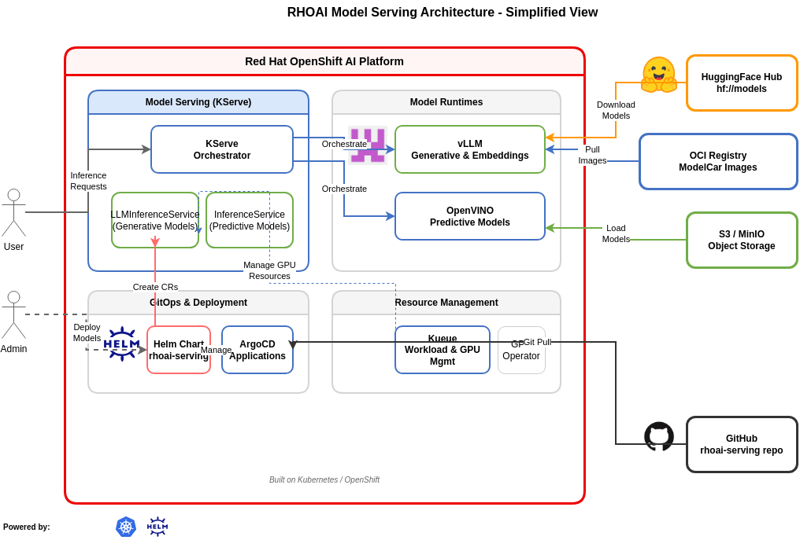

# RHOAI Serving

This repository showcases how to deploy Predictive and Generative AI models on OpenShift using RHOAI.

**Architecture notes** (routes, llm-d, naming, CPU worker overrides): see [docs/README.md](docs/README.md).

## Prerequisites

- OpenShift Container Platform 4.20+.
- OpenShift GitOps.
- OpenShift AI.

If you want to fast-forward the installation of your cluster, you can use these two repositories of mine:

- [ocp-on-aws](https://github.com/alvarolop/ocp-on-aws), to install an OpenShift cluster with auth, GitOps, Certificates and OCP-Lightspeed on AWS with just one click.
- [rhoai-gitops](https://github.com/alvarolop/rhoai-gitops), to install Red Hat OpenShift AI on your cluster with all the dependencies (OCP Pipelines, Kueue, Node Feature Discovery, Nvidia GPU Operator, Authorino, etc.) with just one click.

## Introduction

In this repository, we will showcase all the features of RHOAI Serving. Since OpenShift AI 3.0, the serving of models is configured differently based on the purpose of the model. Therefore, we will explore the following scenarios:

1. Serving **Predictive** models using OpenVINO.
2. Serving **Predictive** models using MLServer (Seldon).
3. Serving **Generative** models using vLLM.
4. Serving **Generative** models using vLLM and distributed across multiple GPUs.
5. Serving **Generative** models using vLLM and llm-d routing for inference acceleration.
6. Serving **Generative** models using vLLM and llm-d routing with prefill and decode disaggregation.
7. Serving **Embeddings** models using MLServer.
8. Serving **Vision Language Models** (VLMs) using vLLM.
9. Serving **Guardrails** models for TrustyAI.

> [!NOTE]
> Independently of the purpose of the model, we will use the `kserve` operator to serve the model using the **Standard** deployment mode (formerly called RawDeployment) since it is the most flexible and powerful mode.

## Testing

Comprehensive testing guide covering functional validation, performance testing, and autoscaling:

**📖 [Testing Documentation](testing/README.md)**

Quick tests:
- **Functional - Predictive**: `testing/01-functional/test-distilbert.sh`
- **Functional - Generative**: `testing/01-functional/test-generative.sh`
- **Performance - HPA**: `testing/02-load-predictive/run-k6-container-hpa.sh`
- **Performance - KEDA**: `testing/02-load-predictive/run-k6-container-keda.sh`

## Architecture Components

The integrated KServe + llm-d + OpenVINO system comprises layered responsibilities:

| Component | Role |
|-----------|------|
| **KServe** | Model serving orchestration (Standard deployment mode, formerly RawDeployment) |
| **LLMInferenceService** | CRD for serving generative models |
| **llm-d** | Distributed inference: inference gateway plus the EPP scheduler that routes each request to a replica |
| **MaaS gateway** | Default gateway for generative models: API keys, subscriptions and token limits |
| **Kueue** | Queues and GPU quota (reserved-spot queues from rhoai-gitops), selected through the HardwareProfile |
| **DRA claim templates** | Shared GPU sizes defined by the platform team; models reference them by name |
| **OpenVINO Model Server** | Serving runtime for predictive models |
| **TrustyAI / NeMo Guardrails** | Bias and drift monitoring, and guardrails for generative models |



*Simplified view (April 2026): it predates MaaS as the default gateway and DRA, see the table above.*

> [!TIP]
> For more details, see the [KServe blog post on cloud-native AI inference with llm-d](https://kserve.github.io/website/blog/cloud-native-ai-inference-kserve-llm-d).

## Helm Chart Usage

Every model is deployed the same way: render the chart with `chart/values.yaml` plus one model overlay, and pipe it to `oc apply` (no Helm release is created).

```bash
helm template <name> chart/ -f chart/values.yaml -f chart/values-<model>.yaml | oc apply -f -
```

Run it from the repository root with `oc` logged in. All overlays deploy into the `models-as-a-service` namespace.

### Deploy a model

```bash
# ===================== GPU: fits 1x L4 (AWS g6 demo) =====================

# Generative (vLLM)
helm template qwen3-8b chart/ -f chart/values.yaml -f chart/values-qwen3-8b-fp8-dynamic.yaml | oc apply -f -
helm template gpt-oss-20b chart/ -f chart/values.yaml -f chart/values-gpt-oss-20b.yaml | oc apply -f -
helm template granite-4-1-8b-fp8 chart/ -f chart/values.yaml -f chart/values-granite-4-1-8b-fp8.yaml | oc apply -f -
helm template gemma-4-12b-it-fp8-dynamic chart/ -f chart/values.yaml -f chart/values-gemma-4-12b-it-fp8-dynamic.yaml | oc apply -f -

# Guardrails
helm template granite-guardian-4-1-8b chart/ -f chart/values.yaml -f chart/values-granite-guardian-4.1-8b.yaml | oc apply -f -

# Embeddings
helm template bge-m3 chart/ -f chart/values.yaml -f chart/values-bge-m3.yaml | oc apply -f -
helm template nomic-embed-text-v2-moe chart/ -f chart/values.yaml -f chart/values-nomic-embed-text-v2-moe-gpu.yaml | oc apply -f -

# ===================== GPU: needs H100 / multi-GPU (production) =====================

# Generative (vLLM, 1x H100)
helm template gemma-4-26b-a4b-fp8 chart/ -f chart/values.yaml -f chart/values-gemma-4-26b-a4b-fp8.yaml | oc apply -f -
helm template qwen38-27b-fp8 chart/ -f chart/values.yaml -f chart/values-qwen3.8-27b-fp8.yaml | oc apply -f -
helm template devstral-small-2-24b-instruct chart/ -f chart/values.yaml -f chart/values-devstral-small-2-24b-instruct.yaml | oc apply -f -

# Generative (vLLM, 2 GPUs with tensor parallelism)
helm template llama-3-3-70b chart/ -f chart/values.yaml -f chart/values-llama-3.3-70b.yaml | oc apply -f -

# ============================ CPU (no GPU needed) ============================

# Generative (vLLM CPU image)
helm template tinyllama-1b chart/ -f chart/values.yaml -f chart/values-tinyllama-1b.yaml | oc apply -f -
helm template granite-3-3-2b-instruct chart/ -f chart/values.yaml -f chart/values-granite-3-3-2b-instruct.yaml | oc apply -f -

# Embeddings (vLLM CPU image)
helm template nomic-embed-text-v1-cpu chart/ -f chart/values.yaml -f chart/values-nomic-embed-text-v1-cpu.yaml | oc apply -f -

# Predictive (OpenVINO + TrustyAI)
helm template distilbert chart/ -f chart/values.yaml -f chart/values-distilbert.yaml | oc apply -f -

# Model from S3 / MinIO (example, CPU vLLM)
helm template tinyllama-s3-minio chart/ -f chart/values.yaml -f chart/values-example-minio-s3-tinyllama.yaml | oc apply -f -
```

None of the models listed here is gated. Gated `hf://` models need `--set-file hfToken=.hf_token`, see [Hugging Face token](#hugging-face-token).

### GPUs: DRA or device plugin

**TL;DR:** GPU models request their GPU through a shared `ResourceClaimTemplate` (DRA), named in `serving.dra.claimTemplate` (`gpu-s-x1` embeddings, `gpu-m-x1` L4 demo, `gpu-l-x1` 1x H100, `gpu-xl-x1` 1 GPU 140 Gi+, `gpu-xl-x2` 2 GPUs). The platform team defines the templates in rhoai-gitops (`06-dra`); this chart creates none. CPU models are unaffected.

On a cluster **without** the NVIDIA DRA driver (device plugin) add `--set serving.dra.enabled=false` to any command above. Details and diagrams: [docs/010-dra-gpu-claims.md](docs/010-dra-gpu-claims.md).

### Test a model

```bash
testing/01-functional/test-generative.sh models-as-a-service gpt-oss-20b
NAMESPACE=models-as-a-service testing/01-functional/test-distilbert.sh
```

More tests (load, guardrails, routing, MaaS): [testing/README.md](testing/README.md).

### Remove a model

Same command with `oc delete`.:

```bash
helm template gpt-oss-20b chart/ -f chart/values.yaml -f chart/values-gpt-oss-20b.yaml | oc delete -f -
```

### Namespace

Resources go to `namespace.name` (default `models-as-a-service`). The chart does **not** create the namespace: it is owned by the platform (rhoai-gitops creates it, labels it `kueue.openshift.io/managed=true` and creates the LocalQueues and GPU claim templates), so it must already exist.

### Kueue queues

The cluster uses the *reserved-spot* queues from [rhoai-gitops](https://github.com/alvarolop/rhoai-gitops#kueue-queues-reserved-spot): `serving-cq` owns the GPUs (models), `batch-cq` borrows idle ones, and `cluster-queue` serves CPU workloads. The `ClusterQueue` and the `LocalQueue` objects (shared by every model in the namespace) are created by rhoai-gitops.

The queue comes from the **HardwareProfile**: the chart writes the `opendatahub.io/hardware-profile-*` annotation and the RHOAI admission adds `kueue.x-k8s.io/queue-name` itself (verified on `LLMInferenceService` and `InferenceService`). The chart only writes the queue label when it cannot write the annotation (a DRA model on a GPU profile without a DRA variant). It always writes the priority label, because RHOAI 3.5 does not apply the profile priority to an `LLMInferenceService`:

| `serving.hardwareProfile.name` | LocalQueue | Priority label |
|---|---|---|
| `gpu-profile` (`gpu-dra-profile` with DRA) | `serving-lq` | `model-critical` |
| `gpu-batch-profile` | `batch-lq` | `batch-nightly` |
| `cpu-profile` | `default` | none |

The LocalQueue must exist in the namespace. If a pod stays `SchedulingGated`, check the Workload:

```bash
oc get workload -n models-as-a-service
oc describe workload -n models-as-a-service | grep -A3 QuotaReserved   # e.g. "LocalQueue serving-lq doesn't exist"
```

### Chart Documentation (helm-docs)

`chart/README.md` is generated from the `values.yaml` comments with [helm-docs](https://github.com/norwoodj/helm-docs) (see [`chart/HELM_DOCS.md`](chart/HELM_DOCS.md)):

```bash
cd chart/ && make docs
```

### Authentication: llm-d gateway or MaaS

**TL;DR:** the gateway decides how clients authenticate, and the chart renders only what that path needs.

```
openshift-ai-inference (llm-d, no MaaS)      ServiceAccount JWT  ─▶ Role "get" on the model     chart renders SA + token + Role + RoleBinding
maas-default-gateway   (MaaS, the default)   API key             ─▶ MaaSSubscription + AuthPolicy   chart renders nothing (platform CRs in rhoai-gitops)
```

- Default is MaaS (`serving.routerGatewayRefs`), so models get **no** per-model ServiceAccount, token or Role. Create API keys with `testing/06-maas/retrieve-api-key.sh`.
- With `--set serving.routerGatewayRefs=null` (standard llm-d gateway) and for predictive models, `rbac.yaml` renders the ServiceAccount token flow from the RHOAI docs: `oc get secret <name>-sa-token -n <ns> -o jsonpath='{.data.token}' | base64 -d`.
- NeMo Guardrails always gets the ServiceAccount token (it uses it to call the model).
- `auth.enabled: false` renders neither.

### MaaS tenant with Keycloak (`serving.maas.tenant`)

**TL;DR:** to publish any generative model in the second MaaS tenant (users sign in with Keycloak), add **one flag** to its normal command: `--set serving.maas.tenant=maas-keycloak`.

```bash
helm template qwen3-8b chart/ -f chart/values.yaml -f chart/values-qwen3-8b-fp8-dynamic.yaml \
  --set serving.maas.tenant=maas-keycloak | oc apply -f -
```

With the flag the chart puts the model in the namespace `ai-tenant-maas-keycloak` and points it at the gateway `maas-keycloak`; `namespace.name` and `routerGatewayRefs` of the values file are ignored, and no ServiceAccount token is rendered (MaaS uses API keys). The tenant itself (AITenant, gateway, namespace with its Kueue queues and GPU claim templates) is `maas-keycloak-chart` and the Keycloak realm in rhoai-gitops. It applies to every generative model of `chart/`; predictive models cannot join MaaS and ignore the flag, and guardrails are not supported with it yet.

The model shows up for a user only when a `MaaSSubscription` and a `MaaSAuthPolicy` of the tenant list it. They are created in rhoai-gitops (`configs` of `application-maas-keycloak.yaml`, group names exactly as in the Keycloak token) and refer to the name of the model: the `name:` of its values file (for example `qwen3-8b`, `gemma-4-12b-it-fp8-dynamic`).

```
Keycloak token ──▶ POST /maas-api/v1/api-keys ──▶ sk-oai-… ──▶ POST /v1/chat/completions   (model id as listed by GET /v1/models)
```

### Hugging Face token

Gated or private **`hf://`** checkpoints need a token. Put it in **`.hf_token`** (git-ignored; see **`.hf_token.example`**) or export **`HF_TOKEN`**. The chart creates **`hf-secret`** and mounts **`HF_TOKEN`** only when **`model.uri`** starts with **`hf://`** and **`hfToken`** is non-empty at render time ([KServe / Hugging Face storage](https://kserve.github.io/website/docs/model-serving/storage/providers/hf)). Public **`hf://`** models in this repo (for example Nomic) can deploy without a token.

> [!TIP]
> **`oci://`** ModelCars (Qwen3-8B, GPT-OSS 20B, Devstral, Gemma and Granite 4.1 here) do not use Hugging Face download auth.

### Model notes

- **Embeddings** (`bge-m3`, `nomic-embed-text-v2-moe`): GPU, platform vLLM image, `gpu-profile`, `--task embedding`. Call `/v1/embeddings` with `spec.model.name`. See [vLLM pooling models](https://docs.vllm.ai/en/latest/models/pooling_models/embed/).
- **MaaS**: by default (`serving.routerGatewayRefs` in `values.yaml`) generative models attach to the MaaS gateway (`maas-default-gateway` in `openshift-ingress`); to use the standard llm-d gateway (`openshift-ai-inference`) set `--set serving.routerGatewayRefs=null`; list gateways with `oc get gateway.networking.k8s.io -A`. The namespace must be allowed by the gateway.
- **Guardrails**: `values-granite-guardian-4.1-8b.yaml`; the generative overlays can also enable `guardrails` (NeMo).

### Extra Runtime Arguments

You can pass extra arguments to the model runtime via `extraArgs` in model value files or inline with `--set`:

- **Generative models**: Arguments are joined into the `VLLM_ADDITIONAL_ARGS` environment variable.
- **Predictive models**: Arguments are appended as container CLI arguments.

For example, vLLM tool/function calling (only if your **vLLM image** actually contains the template file under `.../vllm/transformers_utils/chat_templates/`; using a missing name makes the server exit at startup):

```yaml
extraArgs:
  - "--enable-auto-tool-choice"
  - "--tool-call-parser hermes"
  - "--chat-template <template.jinja>"
```

Granite 4 models should use the tokenizer template by default; Granite-3.3-specific template filenames are not bundled in every RHOAI / vLLM release.

You can also pass arbitrary environment variables via `extraEnv`:

```yaml
extraEnv:
  - name: VLLM_CONFIGURE_LOGGING
    value: "1"
```

### TrustyAI Monitoring

Enable [TrustyAI](https://docs.redhat.com/en/documentation/red_hat_openshift_ai_self-managed/3.5/html/monitoring_your_ai_systems/) for bias and data drift monitoring by setting `trustyai.enabled: true` in a model's values file. This deploys a `TrustyAIService` CR and the required `kserve-logger-ca-bundle` ConfigMap in the model's namespace.

```yaml
trustyai:
  enabled: true
```

TrustyAI supports PVC (default) or DATABASE storage backends. See `chart/values.yaml` for all configuration options.

> [!NOTE]
> Before enabling TrustyAI, ensure the TrustyAI component is enabled in your OpenShift AI Data Science Cluster and that monitoring is configured for the model serving platform.

## Nice references to read

- [Serving a Predictive model using Open Model Zoo](https://github.com/openvinotoolkit/open_model_zoo) is a collection of pre-trained models for various tasks.
- [LLMInferenceService Configuration Guide](https://kserve.github.io/website/docs/model-serving/generative-inference/llmisvc/llmisvc-configuration#complete-configuration-example)
- [Good example of llm-inference-service-pd-qwen2-7b-gpu.yaml](https://github.com/red-hat-data-services/kserve/blob/main/docs/samples/llmisvc/single-node-gpu/llm-inference-service-pd-qwen2-7b-gpu.yaml)
